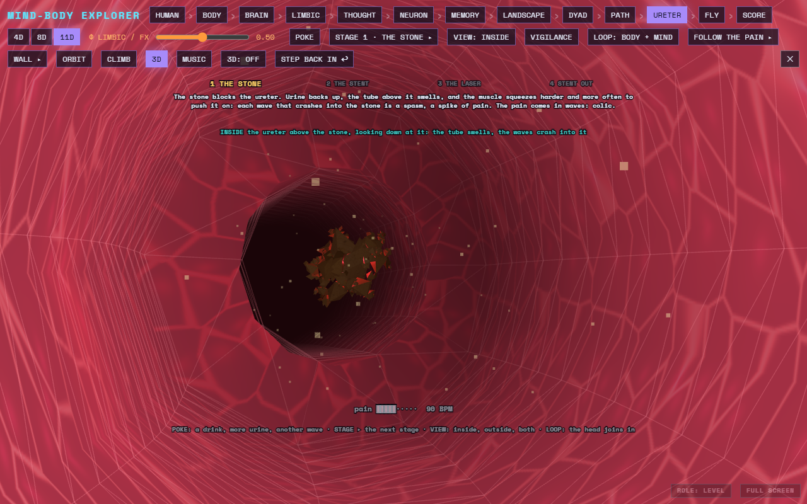
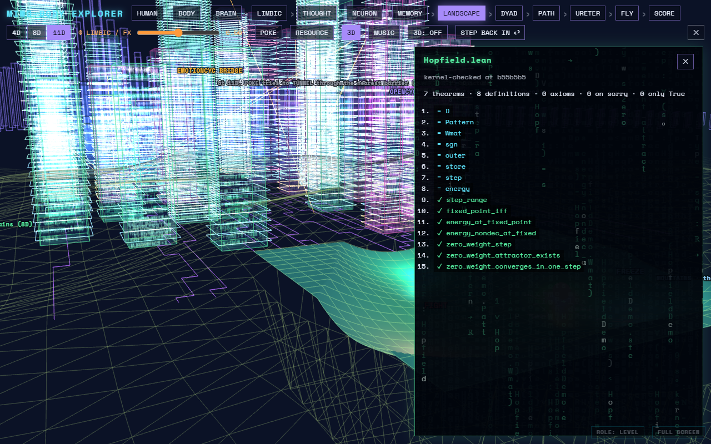

# Sherlock & the Soma Machine (preview)

**The Soma Machine** is the [T]-Theory programme's instrument: a mind–body
explorer from the whole person down to the synapse and out to the cosmos, in
3D. This extension puts it in an editor tab. It also shows **Sherlock**, a
neuro-symbolic compiler for natural language, in the editor: its findings
appear as compiler errors.

## What it does

- **Soma Machine: Open** shows the explorer in a tab: fourteen stops
  (HUMAN, BODY, WAY IN, BRAIN, LIMBIC, THOUGHT, NEURON, MEMORY, LANDSCAPE, DYAD,
  PATH, URETER, FLY, SCORE). **Soma Machine: Go to a Stop…** jumps straight to one.
- **View in Soma Machine** (a lens at the top of a file, or in the editor's
  context menu):
  - a Lean file opens its tower in the *city of code*: every declaration,
    marked ✓ theorem, = definition, ◆ axiom, ✗ resting on `sorry`;
  - a document opens the stop its text (or your selection) is about.
- **Sherlock's findings** appear in Problems as errors and warnings, wherever
  the workspace has Sherlock's ledger (`bld/sherlock/ledger.txt`, one
  `file:line: error|warning: message` per line). They reload when the ledger
  changes. **Sherlock: Check** runs the ledger again. A finding that names a
  Lean declaration offers a quick fix: *View in Soma Machine*.

## What it needs

Nothing for the Soma Machine: it is bundled (a few MB) and runs offline,
apart from the maths and display fonts, which load from the web. No AI model
is involved.

Sherlock's findings come from the [T]-Theory repository
([ITI-Theory/U](https://github.com/ITI-Theory/U)), where Python extracts the
claims and Lean decides them. The extension reads the results.

**Sherlock: Set up** builds Sherlock in a clone of that repository: Mathlib's
prebuilt cache for Lean (several GB), NextKB, the OpenCyc knowledge base (about
20 MB, checked against its SHA-256), OpenCyc in Lean, the affidavits and the
ledger. It needs Lean (elan) and make, asks before it starts, and can take an
hour or more. It does not install Lean.

## Settings

- `sherlock.ledgerFile`: where the findings are (default `bld/sherlock/ledger.txt`).
- `sherlock.checkCommand`: what **Sherlock: Check** runs (default `python sherlock/ledger.py report`).
- `sherlock.setupCommand`: what **Sherlock: Set up** runs (default `make sherlock-setup`).
- `sherlock.codeLens`: show the *View in Soma Machine* lens (default on).

## Note

The Soma Machine is a research and teaching instrument. Its body and mind
views (pain, C-PTSD, ADHD, the stone) are models and illustrations, **not
medical advice**.

© Alistair Johnson. Code Apache-2.0; text and figures CC BY 4.0 (LICENSE.md).
